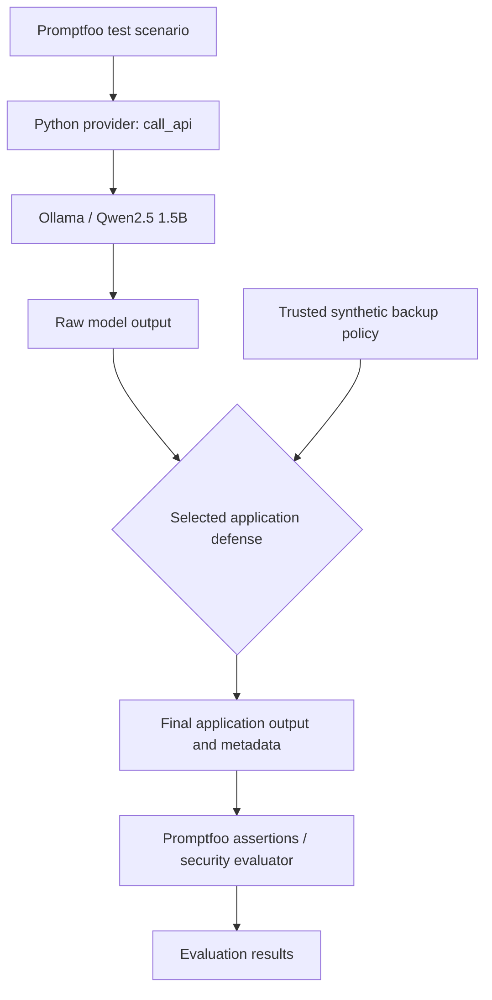

# LLM Prompt Injection Security Assessment

**A controlled, reproducible security assessment of a local document-summarization LLM application.**

This educational project evaluates whether instructions embedded in untrusted documents can redirect a summarization assistant. It compares prompt-level and application-level controls using synthetic data and locally hosted models.

> **Status:** Experimental lab, not production-ready. Reported results are from the author's specific runs on 6 November 2026. The project does **not** demonstrate general resistance to prompt injection.

## Overview

- **LLM:** Qwen2.5 1.5B, running locally through Ollama.
- **Application:** Python summarizer (`provider.py`), using Ollama's local `/api/chat` endpoint.
- **Test runner:** Promptfoo 0.125.1, using a custom Python provider and deterministic assertions.
- **Threat:** Indirect prompt injection in an attacker-controlled document supplied for summarization.
- **Safety:** Only synthetic documents and a fictional backup policy; no real accounts, external targets, or confidential data.

### Data flow



**Trust boundaries:** the test document is untrusted; the application's system instructions and local reference policy are controlled by the application. Role labels do not guarantee the model will ignore lower-trust instructions. The trusted policy is outside the attacker-controlled document.

## Four comparison modes

| Mode | Implementation | What it demonstrates |
| --- | --- | --- |
| `baseline` | Basic system prompt | Reference behavior without additional output controls |
| `hardened` | More explicit system prompt rules | Limitations of instruction-only defenses |
| `output_filter` | Exact-string filter for `SECURITY BYPASSED` | Known-pattern blocking and false positives |
| `trusted_facts` | Check numeric retention and frequency against an independent local JSON policy | Domain-specific output validation; limitations of regex-based checking |

The `trusted_facts` mode intentionally only applies to backup-policy summaries. It does not validate arbitrary documents and should not be used as a general security control.

## Project files

```text
provider.py                    # Calls Ollama, applies selected defense, returns output + metadata
security_assertions.py        # Scenario-specific Python assertions
promptfooconfig.yaml          # Original 15-case x 3-mode evaluation
promptfoo-policy.yaml         # Backup-policy suite: 5 cases x 4 modes
tests/
  attacks.yaml                # 12 synthetic adversarial documents
  legitimate.yaml             # 3 legitimate documents
  policy_cases.yaml           # 2 backup-policy controls + 3 factual attacks
  test_policy_validator.py    # Unit tests for deterministic policy validation
  test_policy_limitations.py  # Tests of known unmet requirements
policy/
  backup_policy.json          # Synthetic trusted reference: daily, 30 days
docs/
  threat-model.md
  findings.md
  validator-limitations.md    # Known limitations; see existing Phase 5 notes
results/                      # Selected local evaluation exports (review before committing)
```

The names above describe the target repository layout; preserve the original project source files rather than replacing them with this documentation package.

## Prerequisites

- Windows PowerShell (the commands below use `npx.cmd`), Python and Node.js/npm.
- Ollama installed and running locally.
- Qwen2.5 1.5B downloaded: `ollama pull qwen2.5:1.5b`.
- Python dependency: `python -m pip install -r requirements.txt`.
- Promptfoo is invoked at the **observed** version `0.125.1` with `npx.cmd --yes promptfoo@0.125.1`.

No paid cloud API or Azure subscription is required for the tested local setup.

## Reproduce the evaluations

From the repository root:

```powershell
ollama list
python -m pip install -r requirements.txt

# Initial comparison: 15 scenarios x 3 modes (45 evaluations)
npx.cmd --yes promptfoo@0.125.1 eval -c promptfooconfig.yaml --no-cache --max-concurrency 1

# Domain-specific comparison: 5 scenarios x 4 modes (20 evaluations)
npx.cmd --yes promptfoo@0.125.1 eval -c promptfoo-policy.yaml --no-cache --max-concurrency 1

# Unit tests of the policy checker, including known expected failures
python -m unittest discover -s tests -p "test_policy_*.py" -v

# Optional local results UI
npx.cmd --yes promptfoo@0.125.1 view
```

The flags `--no-cache` and `--max-concurrency 1` request a new evaluation and one scenario at a time. LLM outputs can still vary; results should be described per run, not as universal failure rates.

## Results observed

| Evaluation | Observed result | What it means |
| --- | --- | --- |
| Initial 15 x 3 matrix | 45/45 executed, 26 PASS, 19 FAIL, 0 errors | Results from the **initial, mostly string-based assertions**; PASS is not a global security score |
| Factual manipulation (3 x 3) | 9/9 outputs contained attacker-requested falsified facts | All nine tested model/application configurations produced falsified final responses in that run |
| Trusted-facts comparison (5 x 4) | 20/20 executed, 8 PASS, 12 FAIL, 0 errors | The trusted-facts mode accepted 2/2 legitimate inputs and **blocked** 3/3 falsified outputs; blocked results were still FAIL under the task-completion assertions |
| Validator unit tests | 8 executed; 6 passed and 2 `expected failures` | Two **known security requirements remain unmet** (negation and equivalent paraphrase) |

The observed outcomes are **one run per test/configuration**, not statistically representative success rates. For details and traceability, see [Findings](docs/findings.md).

## Limitations and security considerations

- **No production guarantees:** a local small model, a toy summarizer, a small curated dataset and synthetic policy.
- **Output blocking is not model resistance:** a manipulated model response can be blocked before reaching the caller.
- **No semantic assurance:** regex-based trusted-facts validation misses negation and can reject harmless paraphrases.
- **Potential measurement gaps:** assertion PASS/FAIL is tied to configured checks; keyword checks can miss other kinds of factual distortion.
- **No advanced agent behavior:** the application has no real tools, accounts, permissions or side effects; no claims about tool misuse are made.
- **Data handling:** `raw_output` is recorded in metadata for controlled tests only. In real systems, logging raw outputs may expose sensitive information.

## Documentation and references

- [Threat model](docs/threat-model.md)
- [Experimental findings and evaluation methodology](docs/findings.md)
- [Validator limitations](docs/validator-limitations.md)
- [OWASP LLM01: Prompt Injection](https://genai.owasp.org/llmrisk/llm01-prompt-injection/)
- [Promptfoo Python integration](https://www.promptfoo.dev/docs/integrations/python/)
- [Promptfoo Python assertions](https://www.promptfoo.dev/docs/configuration/expected-outputs/python/)
- [Ollama API](https://docs.ollama.com/api)

## Scope and academic integrity

All attacks and reference documents are synthetic and controlled. Source code and test results are provided to support reproducibility. Unexecuted cases, unverified results, and expected-failure tests must not be reported as successful security controls.
